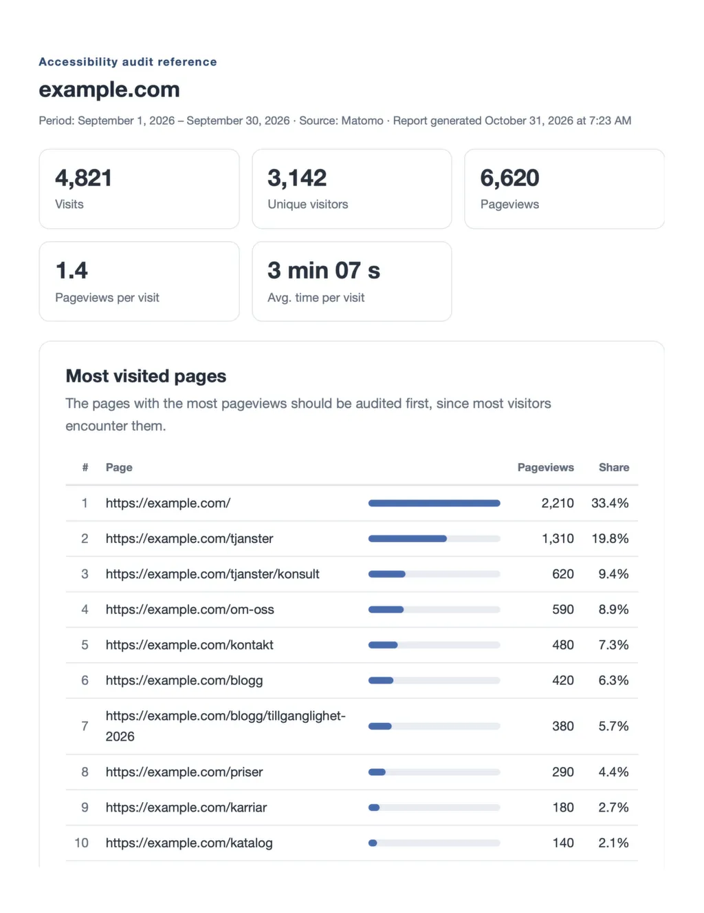

# Matomo Reporter Template

Shared tooling for pulling aggregated Matomo analytics per site and building a self-contained HTML report to use as reference when planning and prioritizing an accessibility audit (WCAG): which pages to audit first, which devices/browsers to test, and which error pages need attention.



Aggregated statistics only – no visitor-level data. Any number of sites are supported; each site is a small config file.

## Layout

```
.
├── .secrets/           # env.example template; .env holds your credentials (gitignored)
├── config/             # one <slug> file per tracked site (shell syntax, sourced — never run)
├── data/               # generated: raw JSON per site in data/<slug>/ (gitignored)
├── docs/               # detailed guide: docs/how-to.md
├── reports/            # generated: reports/<slug>--<start>_<end>[--all].html/.pdf (gitignored)
├── test/               # synthetic demo fixtures (no real visitor data)
├── settings.json       # global settings: report language, PDF paper, table row counts, footer
└── scripts/            # shared tooling (site-independent)
    ├── fetch.sh              # generic single-report fetcher
    ├── pull_audit.sh         # audit pull – aggregated reports only
    ├── pull_all.sh           # deep-dive pull incl. visitor-level rows
    ├── settings.mjs          # settings.json loader used by the builders
    ├── read-settings.sh      # settings.json reader for the pull scripts
    ├── locales/              # report texts per language (sv, en, fr, de, es)
    ├── report-common.mjs     # shared report atoms, styles, PDF pipeline
    ├── build-report-audit.mjs# audit report builder (pull_audit data)
    └── build-report-all.mjs  # traffic-overview builder (pull_all data)
```

The slug is the site config file name and comes from the domain with dots as dashes: `test.example.com` → `test-example-com`.

## One-time setup

```bash
cp .secrets/env.example .secrets/env
$EDITOR .secrets/env      # fill in MATOMO_URL and MATOMO_TOKEN
chmod +x ./scripts/pull_audit.sh
chmod +x ./scripts/build-report-audit.mjs
```

The token needs **view** access. In Matomo 5: Personal settings → Security → Auth tokens. Create a dedicated token for this work and revoke it when done. `.secrets/env` is listed in `.gitignore` and must never be committed.

## Settings

`settings.json` (repo root) holds the global settings shared by every site. Delete it or leave keys out and the defaults apply; an invalid value stops the build with a message.

| Key | Values | Default | What it does |
| --- | --- | --- | --- |
| `language` | `en` `fr` `de` `es` `sv` | `en` | Report language: all headings, labels, notices and date/number formats in the reports. The pull also sends it to Matomo, so row labels (countries, referrer types, …) come back in the same language. |
| `pdf.paper` | `A4` `Letter` | `Letter` | PDF page size (the print `@page` rule). |
| `topRows.*` | integers ≥ 1 | see file | How many rows the top tables show (pages, browsers, resolutions, …). |
| `footer.organization` | string | empty | When set, the report footer says "generated by … for <organization>". |

The report language can be overridden per run without touching the file: a `--lang=<code>` flag on the builders wins, then a `REPORT_LANG` environment variable, then `settings.json`, then the language recorded in the pulled data (`period.json`), then Swedish. Note that switching the language does not re-translate already-pulled data – row labels from Matomo keep the language they were pulled with until the next pull, while everything else (headings, tables, notices) follows the report language immediately.

## Pull and build

```bash
./scripts/pull_audit.sh test-example-com                    # last full calendar month
./scripts/build-report-audit.mjs test-example-com
```

Custom date span:

```bash
./scripts/pull_audit.sh test-example-com 2026-09-01 2026-09-30
./scripts/build-report-audit.mjs test-example-com
```

All sites at once:

```bash
./scripts/pull_audit.sh all
./scripts/build-report-audit.mjs all
```

## Try it without Matomo

Synthetic demo data (no real visitors) ships in `test/fixtures/test-example-com/`. Copy it into place and build:

```bash
cp -R test/fixtures/test-example-com data/
node scripts/build-report-audit.mjs test-example-com --pdf
node scripts/build-report-all.mjs test-example-com --pdf
```

The reports land in `reports/`; remove `data/test-example-com` when done. The fixtures also serve as a schema reference for the JSON the pull scripts write.

## Scripts

- `pull_audit.sh <slug|all> [start] [end]` – aggregated reports only (audit-ready); honors `REPORT_LANG` from the environment or `settings.json`
- `pull_all.sh <slug|all> [start] [end]` – full set including visitor-level Live rows; handle that data with care
- `build-report-audit.mjs <slug|all> [--pdf|--no-pdf] [--lang=<code>]` – accessibility-audit reference report
- `build-report-all.mjs <slug|all> [--pdf|--no-pdf] [--lang=<code>]` – wider traffic overview for the web team
- `create_audit_reports_for_all_sites.sh [start] [end] [--pdf|--no-pdf] [--lang=<code>]` – pull + build every configured site in one go (build is skipped when any pull fails)

Reports are single self-contained HTML files (inline CSS and SVG, no external requests) and work offline. The builder optionally renders a tagged (accessible) PDF via a Chromium-based browser; title and language metadata are verified on every build.

## Accessibility

Both output formats are built for assistive technology:

- **HTML** uses semantic landmarks (`header`, `main`, `footer`), a single `h1` with a clean heading hierarchy, data tables with `caption` and column plus row headers (`th scope`), inline SVG charts with accessible names, descriptions and per-segment labels, the report language in `lang` on the document, and AA-passing color contrast. Generated reports pass axe-core (WCAG 2.0/2.1 A + AA and best practices) with zero violations; the one item axe cannot automate – the contrast of the SVG axis tick labels – is verified manually (muted gray on white, 5.55:1 against the required 4.5:1).
- **PDF** is written as a tagged PDF: Chromium prints a structure tree, and the document title and language travel from the HTML `<title>` and `lang` attribute into the PDF metadata. Every build verifies the result with a byte-level check and prints it in the ok line (`tagged, lang en, title "..."`); a loud warning appears if a PDF ever comes out untagged.
- **Compression never breaks tagging**: the optional Ghostscript step only replaces a PDF when the smaller copy still carries the tag structure. Ghostscript 10.x drops it, so tagged PDFs stay uncompressed – the font swap in the PDF-only CSS already keeps sizes reasonable.

## Add a new site

Create `config/<slug>` with at least `MATOMO_SITE` (idSite) and `MATOMO_DOMAIN`. See `docs/how-to.md` for how to look up the idSite.

## Data protection

The token is read from `.secrets/env` or the environment and never written elsewhere or echoed. `.secrets/env`, `data/` and `reports/` are gitignored and must never be committed.

Full documentation: [`docs/how-to.md`](docs/how-to.md)
